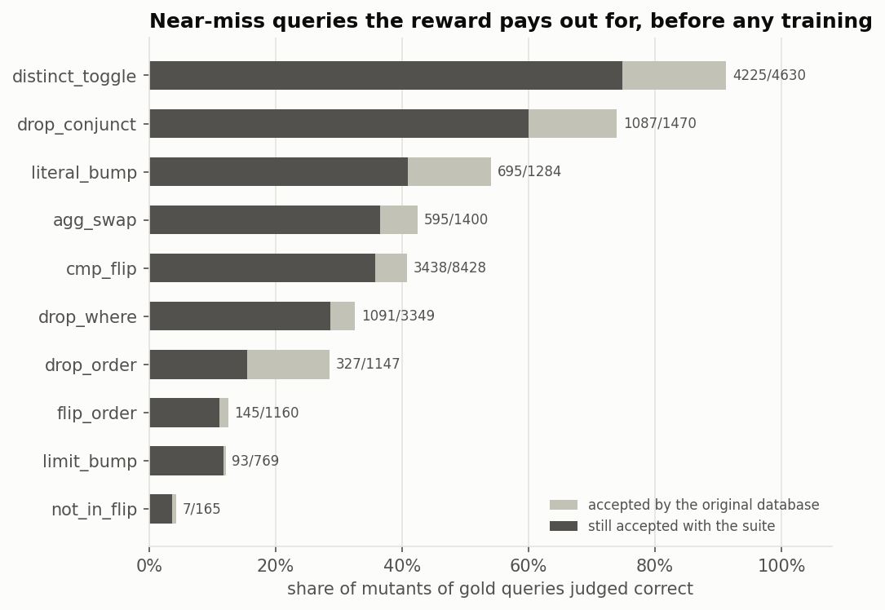
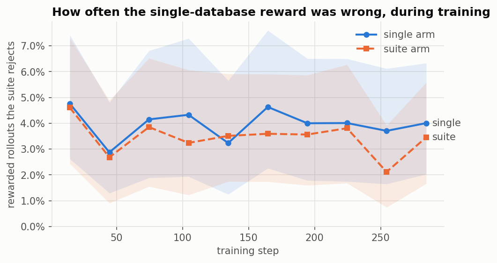
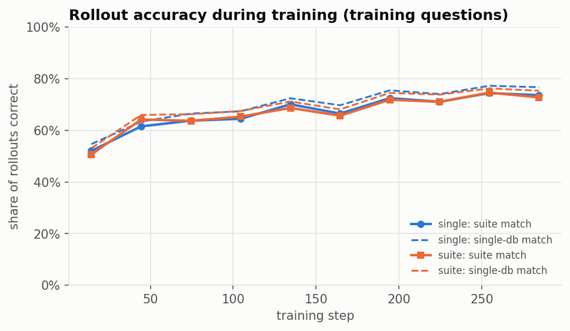
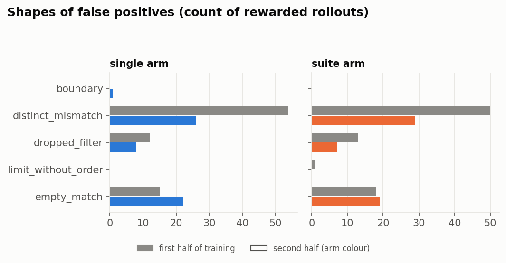
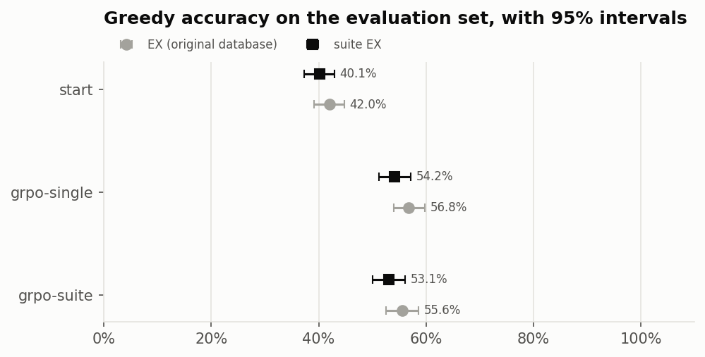
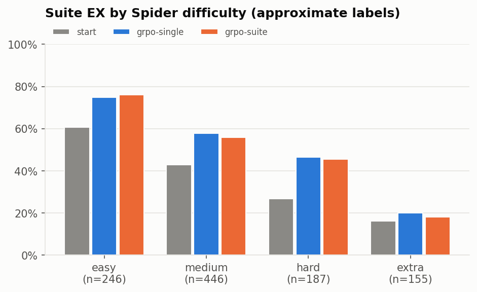

# Mirage: reward fidelity for GRPO text-to-SQL (Qwen2.5-Coder-0.5B, Spider) — seed 0

## Findings

- **Before training**, the single-database check accepts 49.2% of near-miss mutants of gold queries (11703 of 23802, over 166 databases). Excluding DISTINCT toggles, which are often semantically equivalent, it accepts 39.0%. The perturbed suites reject 16.6% of those (15.8% excluding DISTINCT toggles).
- **single arm**: 4.0% of the rollouts the single-database check rewarded were rejected by the suite [2.9, 5.2]; that share showed no detectable drift (change -0.1 points, interval [-2.1, 2.0] spans zero).
- **suite arm**: 3.4% of the rollouts the single-database check rewarded were rejected by the suite [2.5, 4.6]; that share showed no detectable drift (change -0.5 points, interval [-2.4, 1.3] spans zero).
- **grpo-single vs start**, EX: +14.8 points [12.0, 17.6], 207 questions gained, 54 lost (McNemar p=0.000).
- **grpo-single vs start**, suite EX: +14.0 points [11.1, 16.7], 199 questions gained, 54 lost (McNemar p=0.000).
- **grpo-suite vs start**, EX: +13.6 points [10.7, 16.6], 206 questions gained, 65 lost (McNemar p=0.000).
- **grpo-suite vs start**, suite EX: +13.0 points [10.2, 15.9], 196 questions gained, 62 lost (McNemar p=0.000).
- **grpo-suite vs grpo-single**, EX: no detectable difference (-1.2 points, interval [-2.6, 0.3] spans zero).
- **grpo-suite vs grpo-single**, suite EX: no detectable difference (-1.1 points, interval [-2.4, 0.3] spans zero).
- **start** loses 1.8 points going from EX to suite EX: answers that were right only on the original data.
- **grpo-single** loses 2.6 points going from EX to suite EX: answers that were right only on the original data.
- **grpo-suite** loses 2.5 points going from EX to suite EX: answers that were right only on the original data.
- **Warning:** the arms are not a clean comparison: arm configs differ beyond the reward mode: {'grpo-single': 'd45d537b3e3b', 'grpo-suite': '46102dda95ff'}

## 1. The reward's blind spot, before training

Each gold query was mutated into near misses (one small, plausible mistake each). A mutant that returns the same rows as gold on the original database would be **rewarded** by a single-database execution check. The suite is a few perturbed copies of each database chosen to reject as many of those as possible.

| | value |
|---|---|
| databases / suite variants | 166 / 480 |
| mutants tested | 23802 |
| accepted by the original database | 11703 (49.2%) |
| of those, rejected by the suite | 1940 (16.6%) |
| same two rates, excluding DISTINCT toggles | 39.0% / 15.8% |

Some mutants are equivalent to the gold query (adding DISTINCT to an already-unique column), so no database can reject them; the catch rate is a lower bound on how much the suite tightens the reward.

## 2. Did the reward lie more as training went on?

Every rollout in both arms was scored by both checks. A **false positive** is a rollout the single-database check rewarded and the suite rejected. Intervals are bootstrapped over questions, not rollouts.

| arm | rollouts | match (single) | match (suite) | false-positive share | drift, last vs first quarter | groups with signal |
|---|---|---|---|---|---|---|
| single | 19200 | 69.8% | 67.0% | 4.0% [2.9, 5.2] | -0.1 pts [-2.1, 2.0] | 49.1% |
| suite | 19200 | 69.2% | 66.9% | 3.4% [2.5, 4.6] | -0.5 pts [-2.4, 1.3] | 47.8% |

✱ interval excludes zero.

single: latest false-positive examples (12)

| step | db | rewarded SQL | flags |
|---|---|---|---|
| 299 | club_1 | `SELECT LName FROM Student WHERE StuID IN (SELECT StuID FROM Member_of_club WHERE ClubID IN (SELECT ClubID FROM Club WHERE ClubName = 'Hopkins Student Enterprises')) ORDER BY Age DESC LIMIT 1` | - |
| 298 | mountain_photos | `SELECT camera_lens.name, COUNT(*) 
FROM camera_lens 
JOIN photos ON camera_lens.id = photos.camera_lens_id 
GROUP BY camera_lens.name 
ORDER BY COUNT(*) ASC` | - |
| 293 | student_1 | `SELECT FirstName, LastName FROM teachers WHERE Classroom = (SELECT Classroom FROM list GROUP BY Classroom ORDER BY COUNT(*) DESC LIMIT 1)` | - |
| 292 | company_office | `SELECT Stories FROM buildings WHERE Height = ( SELECT MAX(Height) FROM buildings )` | - |
| 292 | party_people | `SELECT Member_Name FROM member WHERE Member_ID NOT IN (SELECT Member_in_charge_ID FROM party_events)` | - |
| 291 | body_builder | `SELECT SUM(Total) FROM body_builder WHERE People_ID IN (
  SELECT People_ID FROM people WHERE Birth_Date LIKE '%January%'
)` | - |
| 286 | formula_1 | `SELECT MAX(fastestLapSpeed) FROM results WHERE raceId = (SELECT raceId FROM races WHERE name = 'Monaco Grand Prix' AND `year` = 2008)` | - |
| 285 | cre_Docs_and_Epenses | `SELECT Project_ID, Project_Details FROM Projects WHERE Project_ID IN (
    SELECT Project_ID FROM Documents GROUP BY Project_ID HAVING COUNT(*) >= 2
)` | - |
| 282 | customers_and_invoices | `SELECT product_name FROM Products WHERE product_id NOT IN (SELECT product_id FROM Order_Items)` | - |
| 282 | customers_card_transactions | `SELECT customer_first_name, customer_last_name, customer_phone FROM Customers WHERE customer_id = (SELECT customer_id FROM Customers_Cards WHERE card_number = '4560596484842')` | - |
| 281 | wrestler | `SELECT DISTINCT Reign FROM wrestler WHERE Location != 'Tokyo, Japan'` | - |
| 279 | products_gen_characteristics | `SELECT COUNT(characteristic_id) FROM Characteristics WHERE characteristic_type_code = 'flax'` | - |

suite: latest false-positive examples (12)

| step | db | rewarded SQL | flags |
|---|---|---|---|
| 293 | student_1 | `SELECT T1.FirstName, T1.LastName
FROM teachers AS T1
JOIN list AS T2 ON T1.Classroom = T2.Classroom
GROUP BY T1.Classroom
ORDER BY COUNT(*) DESC
LIMIT 1` | - |
| 292 | company_office | `SELECT Stories FROM buildings WHERE Height = (SELECT MAX(Height) FROM buildings)` | - |
| 292 | party_people | `SELECT Member_Name FROM member WHERE Member_ID NOT IN (SELECT Member_in_charge_ID FROM party_events)` | - |
| 291 | body_builder | `SELECT SUM(Total) FROM body_builder WHERE People_ID IN (SELECT People_ID FROM people WHERE Birth_Date LIKE '%January%')` | - |
| 288 | tracking_software_problems | `SELECT product_name FROM Product ORDER BY product_id` | distinct_mismatch |
| 285 | cre_Docs_and_Epenses | `SELECT Project_ID, Project_Details FROM Projects
WHERE Project_ID IN (
  SELECT Project_ID FROM Documents
  GROUP BY Project_ID
  HAVING COUNT(*) >= 2
)` | - |
| 283 | epinions_1 | `SELECT DISTINCT name FROM useracct WHERE u_id NOT IN (
  SELECT u_id FROM review
)` | distinct_mismatch |
| 282 | customers_and_invoices | `SELECT product_name FROM Products WHERE product_id NOT IN (SELECT product_id FROM Order_Items)` | - |
| 282 | customers_card_transactions | `SELECT customer_first_name, customer_last_name, customer_phone FROM Customers WHERE customer_id = (SELECT customer_id FROM Customers_Cards WHERE card_number = 4560596484842)` | - |
| 281 | wrestler | `SELECT DISTINCT Reign FROM wrestler WHERE Location != 'Tokyo, Japan'` | - |
| 280 | voter_2 | `SELECT DISTINCT LName FROM Student WHERE Advisor = 8741 AND Sex = 'M'` | - |
| 279 | products_gen_characteristics | `SELECT count(*) FROM Characteristics WHERE characteristic_type_code = 'flax'` | - |

> **Arms differ beyond the reward:** arm configs differ beyond the reward mode: {'grpo-single': 'd45d537b3e3b', 'grpo-suite': '46102dda95ff'}

## 3. Held-out accuracy

Evaluation set: **Spider dev (1,034 questions, 20 unseen databases)**. Greedy decoding, identical prompt for every model.

| model | n | ex | suite_ex | pass@1 | pass@8 | suite_pass@8 | maj_ex | maj_suite_ex | FP share |
|---|---|---|---|---|---|---|---|---|---|
| start | 1034 | 42.0% [39.1, 44.8] | 40.1% [37.2, 42.9] | 33.3% [31.2, 35.3] | 65.2% [62.4, 67.9] | 62.3% [59.4, 65.1] | 56.0% [53.1, 58.9] | 52.5% [49.6, 55.3] | 4.4% |
| grpo-single | 1034 | 56.8% [54.0, 59.8] | 54.2% [51.3, 57.2] | 52.8% [50.2, 55.4] | 69.7% [66.9, 72.5] | 67.0% [64.2, 69.8] | 60.5% [57.6, 63.4] | 57.4% [54.4, 60.5] | 4.6% |
| grpo-suite | 1034 | 55.6% [52.5, 58.6] | 53.1% [50.1, 56.1] | 52.2% [49.6, 54.8] | 70.1% [67.3, 72.9] | 67.0% [64.2, 69.9] | 60.3% [57.3, 63.2] | 57.1% [54.1, 60.1] | 4.5% |

`ex`: matches gold on the original database. `suite_ex`: also on every perturbed variant. `pass@k` from sampled completions (unbiased estimator). `maj_*`: majority vote over samples by execution result.

| comparison | metric | difference | 95% CI | gained / lost | McNemar p |
|---|---|---|---|---|---|
| grpo-single − start | ex | +14.8 pts | [12.0, 17.6] | 207 / 54 | 0.000 |
| grpo-single − start | suite_ex | +14.0 pts | [11.1, 16.7] | 199 / 54 | 0.000 |
| grpo-suite − start | ex | +13.6 pts | [10.7, 16.6] | 206 / 65 | 0.000 |
| grpo-suite − start | suite_ex | +13.0 pts | [10.2, 15.9] | 196 / 62 | 0.000 |
| grpo-suite − grpo-single | ex | -1.2 pts | [-2.6, 0.3] | 21 / 33 | 0.134 |
| grpo-suite − grpo-single | suite_ex | -1.1 pts | [-2.4, 0.3] | 20 / 31 | 0.161 |

### Why the wrong answers are wrong

| failure | start | grpo-single | grpo-suite |
|---|---|---|---|
| syntax | 6 | 0 | 4 |
| schema_link | 410 | 193 | 218 |
| exec_other | 7 | 13 | 9 |
| wrong_tables | 99 | 113 | 105 |
| wrong_select | 19 | 18 | 18 |
| aggregation | 12 | 20 | 18 |
| grouping | 8 | 14 | 13 |
| nesting | 18 | 44 | 41 |
| filter | 16 | 23 | 24 |
| values | 1 | 4 | 4 |
| ordering | 3 | 4 | 4 |
| other | 1 | 1 | 1 |

## What this run does not establish

- **Suites are an approximation of test-suite accuracy.** They are built by a simpler procedure than the official distilled test suites (permutation, jitter, boundary planting and row edits, selected against mutants). For the headline dev number, also run the official evaluator (`mirage score --official`).
- **Mutants are not the policy's mistakes.** The blind-spot rate measures the check against a fixed family of near misses. How often a trained model produces such queries is what the ledger measures, separately.
- **Difficulty labels are recomputed** with a reimplementation of Spider's rule on a different parser and can differ from the official labels on edge cases.
- **One seed per arm unless stated.** RL runs vary between seeds; a difference between arms that is smaller than the seed-to-seed spread is not established by a single pair of runs.
- **Spider is old and small-schema.** Results may not transfer to large, messy production schemas, or to BIRD-style benchmarks with dirty values.
- **Cost figures are list-price arithmetic** from the Vantage run: they exclude engineering time, redundancy and peak-versus-mean provisioning, as Vantage's own report says.
